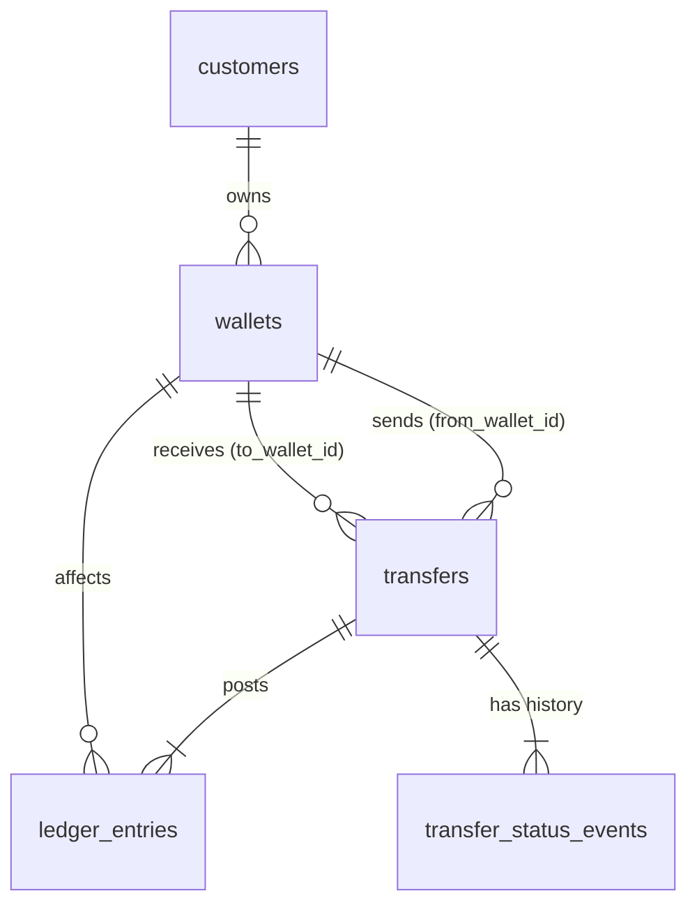

# 01 — Source Schema Design

## Domain

A simple wallet/payments system. Customers hold one wallet per currency and
send transfers between wallets. Every completed transfer produces double-entry
ledger lines, and every status change is recorded as an event.

## Entity–relationship diagram

## Tables

| Table | Type | Primary key | Purpose |
|---|---|---|---|
| customers | Strong | customer_id | A person using the app |
| wallets | Strong | wallet_id | A balance in one currency, owned by a customer |
| transfers | Strong | transfer_id | Movement of money from one wallet to another |
| ledger_entries | Weak | (transfer_id, entry_no) | Double-entry debit/credit lines of a transfer |
| transfer_status_events | Weak | (transfer_id, seq) | Audit trail of a transfer's status changes |

## Data type decisions

| Concern | Decision | Why |
|---|---|---|
| Money | `INTEGER` minor units (fils, cents), column suffix `_minor` | SQLite has no true decimal type; floats lose precision on money |
| Timestamps | ISO-8601 UTC text, e.g. `2026-10-27T10:00:00Z` | SQLite has no native timestamp type. A single fixed format makes text comparison equal time comparison. |
| Enums | `TEXT` + `CHECK (col IN (...))` | SQLite has no enum type; the CHECK makes the allowed set explicit and enforced |
| Nullable fields | `customers.email`, `customers.phone` (at least one required, R17), `transfers.failure_reason`, `transfers.settled_at` | Phone-only and email-only signups are both supported; the other two are only known later in the transfer's lifecycle |

## Business and system rules

| ID | Rule | Enforced in source by |
|---|---|---|
| R01 | Every table has a unique primary key | PRIMARY KEY |
| R02 | Wallets belong to an existing customer; transfers, ledger entries and events reference existing parents | FOREIGN KEY |
| R03 | Required columns are never null | NOT NULL |
| R04 | Status, currency, KYC and direction values come from fixed sets | CHECK |
| R05 | A customer has at most one wallet per currency | UNIQUE (customer_id, currency) |
| R06 | Wallet balance is never negative | CHECK |
| R07 | Transfer and ledger amounts are strictly positive | CHECK |
| R08 | A transfer cannot go from a wallet to itself | CHECK |
| R09 | A transfer cannot settle before it was created | CHECK |
| R10 | A transfer has a failure reason if and only if it failed | CHECK |
| R11 | A transfer has a settlement time if and only if it is completed or reversed | CHECK |
| R12 | Allowed status transitions: pending → completed / failed; completed → reversed | TRIGGER |
| R13 | Ledger entries and status events are never updated or deleted | TRIGGER |
| R14 | A transfer's currency matches both wallets' currency | Application (cross-table) |
| R15 | A completed transfer's ledger debits equal its credits equal its amount | Application (multi-row) |
| R16 | A customer can only be hard-deleted if `abandoned` (and has no wallets, via R02) | TRIGGER + FOREIGN KEY |
| R17 | Every customer has an email or a phone (or both), and each is unique when present | CHECK + UNIQUE |

R14 and R15 span several rows or tables, so the source can't enforce them with
simple constraints. The application enforces them. The warehouse will **assert
all 15 rules**, including these two, so its validation is at least as strict as
the source's.
**Reversals:** `reversed` is a terminal status meaning the funds have already
been returned. The status change and the offsetting ledger entries are written
in one transaction, which is possible because all wallets live in this system.
A reversal that would make the recipient's balance negative is rejected (R06),
and the transfer stays `completed`. A transfer never returns to `pending`.
Reversals through external payment rails would instead be modelled as a new
transfer linked by `reverses_transfer_id`, with its own lifecycle.

## Expected change patterns

| Table | Inserts | Updates | Deletes |
|---|---|---|---|
| customers | New signups | KYC status, phone, status (soft delete: `abandoned` / `closed`) | Retention job only: abandoned signups with no wallets |
| wallets | New wallet | Balance (frequent), status | Never |
| transfers | New transfer | Status changes, settled_at, failure_reason | Never |
| ledger_entries | When a transfer completes or reverses | Never (R13) | Never (R13) |
| transfer_status_events | On every status change | Never (R13) | Never (R13) |

Corrections are made by **adding** records (a reversal), never by editing history.
This is standard for financial systems and makes the CDC stream easy to audit.

**Deletes:** customers are soft-deleted by setting `status`. A retention job
(out of scope here, and simulated in tests) hard-deletes abandoned signups that
never opened a wallet. The CDC must capture these deletes, and the warehouse
must reflect them, even though they are rare.

## Indexes

| Index | Why |
|---|---|
| UNIQUE (customer_id, currency) on wallets | Enforces R05, and also serves "find a customer's wallets" lookups |
| transfers(from_wallet_id), transfers(to_wallet_id) | Foreign-key lookups: a wallet's outgoing and incoming transfers |
| transfers(status, created_at) | Operational queries such as "pending transfers older than X" |
| ledger_entries(wallet_id, created_at) | Building a wallet's statement |
| updated_at on customers, wallets, transfers | Supports timestamp-based reconciliation scans (a fallback check against the CDC log) |